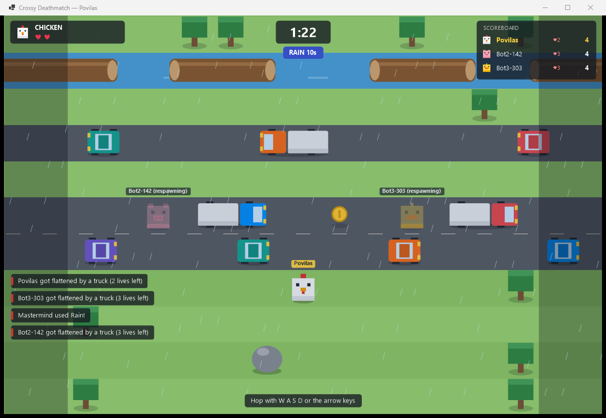

# Crossy Deathmatch

A 2D multiplayer Crossy-Road-style game for T120B516 (Objektinis programų projektavimas).
Three **runners** hop across an endless map of roads, rivers and railways. The fourth player, the
**Mastermind**, watches the whole map from above and throws hazards at them.



- **Language:** C# / .NET 10, no game framework
- **Graphics:** WinForms + System.Drawing (GDI+), everything drawn from rectangles and ellipses
- **Networking:** client–server over SignalR (WebSockets), messages as JSON
- **Persistence:** player profiles and match history in a JSON file (`src/CrossyDeathmatch.Server/data/db.json`)

## Running it

You need the .NET 10 SDK. From the repository root:

```bash
dotnet build CrossyDeathmatch.sln
```

1. **Start the server** (it prints the addresses other machines can use):

   ```bash
   dotnet run --project src/CrossyDeathmatch.Server
   ```

   Options: `--port 5000`, `--min-players 4` (players needed before roles are dealt, 1–4), `--round-seconds 180`.

2. **Start a client for each player** (on the same PC or any PC on the network):

   ```bash
   dotnet run --project src/CrossyDeathmatch.Client
   ```

   Options: `--server http://192.168.1.20:5000`, `--name Povilas`. You can also type both into the first screen.

3. **Not enough people?** Fill the room with bots. Create a room in a client, then:

   ```bash
   dotnet run --project src/CrossyDeathmatch.Bots -- --count 3 --room ABCD
   ```

   Without `--room` the bots create their own public room and print its code.
   `--count 4 --exit-after-game` runs a full round with bots only and prints the result (a quick smoke test).

For quick testing with fewer players, start the server with `--min-players 2 --round-seconds 60`.

## How a game goes

1. Sign in with a nickname (nicknames are unique among connected players).
2. Create a public or private room, join one by its 4-letter code, or pick one from the public list.
3. When the room has enough players and **everyone is ready**, the server picks a random Mastermind.
4. Runners pick different animals, everyone readies up again, and the round starts.
5. The round ends when every runner is out (**Mastermind wins**) or the timer runs out
   (**the best surviving runner wins**). Results are saved, and after 10 seconds everyone is back in the room.

If someone leaves while animals are being picked, the room goes back to the lobby. If someone leaves mid-round,
they are marked as left and the round carries on. The host role passes to the next player, and empty rooms close.

### Controls

| Role | Controls |
|---|---|
| Runner | `W A S D` or arrow keys: one hop per press |
| Mastermind | `1`–`5` or click a button to pick an ability, click the map to use it, `Esc` / right-click to cancel |

### Rules and numbers

All tunables live in [`GameRules.cs`](src/CrossyDeathmatch.Shared/GameRules.cs), [`CharacterCatalog.cs`](src/CrossyDeathmatch.Shared/CharacterCatalog.cs) and [`AbilityCatalog.cs`](src/CrossyDeathmatch.Shared/AbilityCatalog.cs).

- **Map:** 13 columns wide and endless. Lanes are generated in groups as runners advance: grass (safe, has trees and pickups), road (cars and trucks), river (stand on logs or drown, and don't get carried off the edge), rail (a train comes after a flashing warning). Difficulty (speed, density) grows with distance.
- **Scoring:** +1 per new lane reached, +5 per coin.
- **Death:** lose a life, respawn on the nearest grass behind you after 1.5 s, then 2 s invulnerable. No lives left means you're out. You can't go back more than 5 lanes.
- **Pickups:** coin, speed boost (hops about 2× faster for 6 s), extra life.

| Animal | Lives | Hop cooldown |
|---|---|---|
| Chicken | 3 | 170 ms |
| Rabbit | 2 | 110 ms |
| Duck | 4 | 230 ms |
| Pig | 5 | 320 ms |

The Mastermind starts with 40 energy and regains 6 per second (max 100).

| Ability | Cost | Cooldown | Target | Effect |
|---|---|---|---|---|
| Send car | 12 | 1.2 s | road lane | extra car |
| Drop boulder | 25 | 3 s | tile | warning for 1 s, crushes, then blocks the tile for 8 s |
| Release fox | 30 | 6 s | grass lane | fox paces the lane for 15 s |
| Rain | 45 | 20 s | — | all runners hop 1.8× slower for 10 s |
| Night | 55 | 25 s | — | runners only see a small circle around themselves for 10 s |

## Architecture

The server runs the game (authoritative server). Clients only send input (`Move`, `UseAbility`, lobby actions).
Every room runs its own 20 Hz loop and sends each player a full snapshot. The client keeps a small buffer of
snapshots and draws about 90 ms in the past, blending between two snapshots so movement stays smooth at 60 fps.

```
Client (WinForms)                         Server (ASP.NET Core)
 ConnectView/LobbyView/RoomView/GameView   GameHub ──► GameServer ──► GameSession (room)
        │                                                               │  20 Hz loop
 ServerConnection ◄──── SignalR / JSON ────► IGameClient messages       ▼
 SnapshotBuffer → WorldRenderer/HudRenderer                            GameRound
                                                          GameMap · MapGenerator · Lane · Obstacles
                                                          Runner · Mastermind · Abilities
                                                          CollisionResolver · ScoreBoard · WorldEffects
                                                        JsonDatabase
```

### Projects and packages

| Project / namespace | Main classes |
|---|---|
| `CrossyDeathmatch.Shared` | `GameRules`, `CharacterCatalog`, `AbilityCatalog`, `IGameClient`, `HubMethods`, DTO records (`SnapshotDto`, `RoomDto`, …), enums |
| `Server.Networking` | `GameHub`, `GameServer`, `GameSession`, `PlayerConnection` |
| `Server.Gameplay` | `GameRound`, `IRoundEvents`, `GameMap`, `MapGenerator`, `Lane`, `TrafficSettings`, `Runner`, `Mastermind`, `WorldEffects`, `CollisionResolver`, `ScoreBoard`, `ScoreEntry` |
| `Server.Gameplay.Obstacles` | `Obstacle` (abstract), `Car`, `Log`, `Train`, `Fox`, `Boulder` |
| `Server.Gameplay.Abilities` | `Ability` (abstract), `IAbilityContext`, `SpawnCarAbility`, `DropBoulderAbility`, `SpawnFoxAbility`, `RainAbility`, `NightAbility` |
| `Server.Persistence` | `JsonDatabase`, `MatchRecord` |
| `Client.Networking` | `ServerConnection`, `SnapshotBuffer` |
| `Client.Rendering` | `WorldRenderer`, `HudRenderer`, `Camera`, `RunnerAnimator`, `Sprites`, `Palette` |
| `Client.Views` | `MainForm`, `ConnectView`, `LobbyView`, `RoomView`, `CharacterCard`, `GameView` |
| `CrossyDeathmatch.Bots` | `Bot`, `BotOptions` |

### Thread safety

- `GameServer` has one lock for players and rooms. Each `GameSession` has its own lock, which its game loop also takes.
- Locks are always taken in the same order: server, then session.
- A session never calls back into the server. Room-list changes are only flagged and broadcast by a timer, so the locks can't deadlock.

## Prototype checklist (requirements part 1, item 5)

- [x] Client–server communication: SignalR hub with JSON; lobby, rooms, ready/roles/animals, input, snapshots
- [x] Graphics: System.Drawing rendering of map, obstacles, animals, effects and HUD
- [x] Game control: grid hopping with the keyboard, Mastermind abilities with keyboard and mouse
- [x] Several rooms in parallel, disconnect handling, results saved to the JSON database
