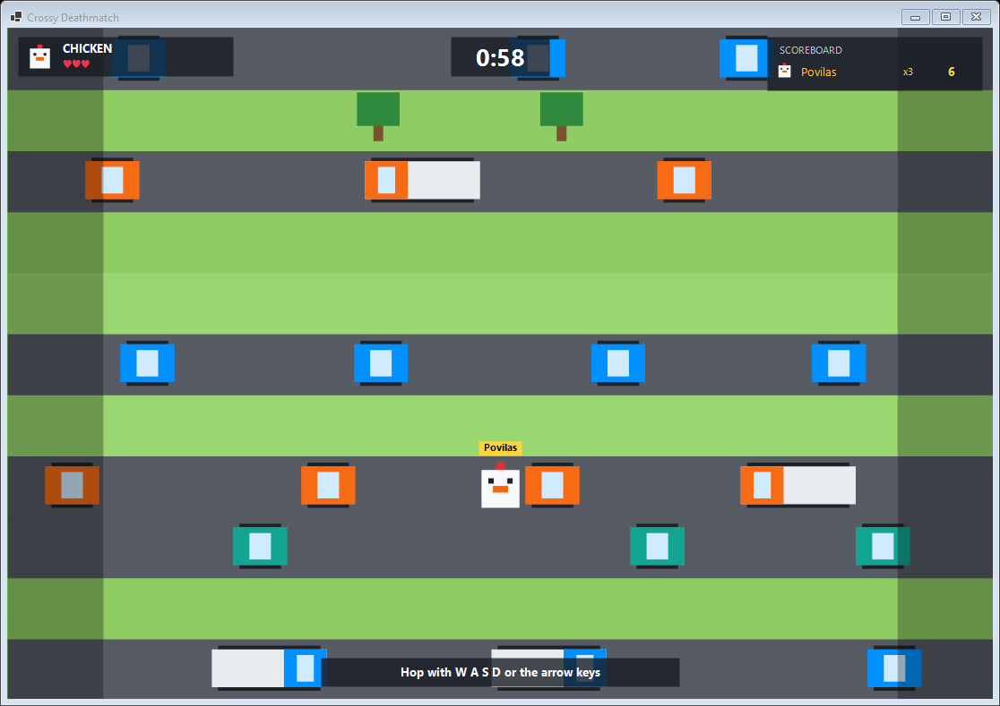
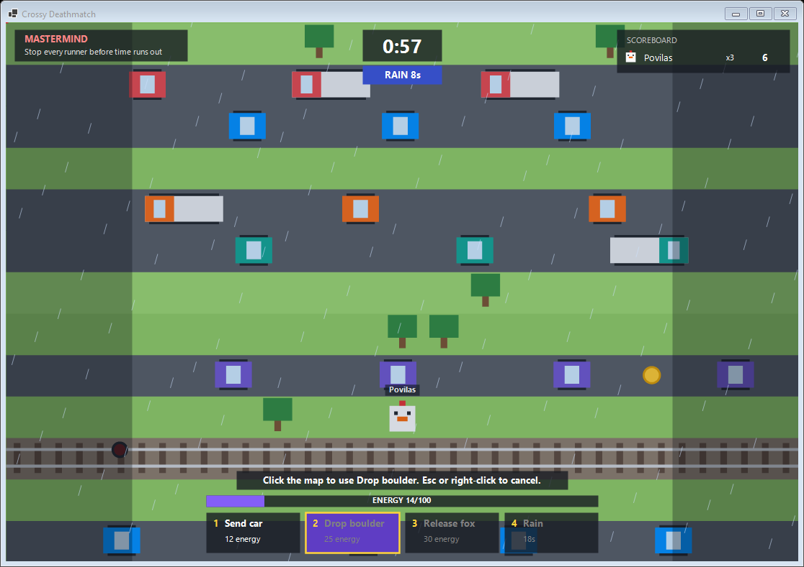

# Crossy Deathmatch

A 2D multiplayer Crossy-Road-style game for T120B516 (Objektinis programų projektavimas).
Runners hop across an endless map of roads and railways. One player, the **Mastermind**, watches
the whole map and throws hazards at them.



- **Language:** C# / .NET 10, no game framework
- **Graphics:** WinForms + System.Drawing, everything drawn from rectangles and ellipses
- **Networking:** client–server over SignalR (WebSockets), game state sent as JSON
- **Kept deliberately simple:** 8 classes and 4 enums, no design patterns

## Running it

You need the .NET 10 SDK. From the repository root:

```bash
dotnet build CrossyDeathmatch.sln
```

1. **Start the server.** It prints the addresses other machines can use.

   ```bash
   dotnet run --project src/CrossyDeathmatch.Server
   ```

   Options: `--port 5000`, `--min-players 4` (players needed before a round starts, 1–4),
   `--round-seconds 180`. To test alone: `--min-players 1 --round-seconds 60`.

2. **Start a client for each player**, on the same PC or any PC on the network:

   ```bash
   dotnet run --project src/CrossyDeathmatch.Client
   ```

   Options: `--server http://192.168.1.20:5000`, `--name Povilas`. Both can also be typed in the window.

## How a game goes

1. Type the server address and a nickname, then **Connect**. Up to 4 players share one lobby.
2. Pick an animal and press **Ready**.
3. When enough players are ready, the round starts. With 2 or more players, one random player becomes the Mastermind.
4. The round ends when every runner is out (**the Mastermind wins**) or the time runs out
   (**the best surviving runner wins**). The result appears in the lobby, and everyone can ready up again.

Players can't join while a round is running. Someone who leaves mid-round is marked as out.

| Role | Controls |
|---|---|
| Runner | `W A S D` or arrow keys: one hop per press |
| Mastermind | `1`–`4` or click a button to pick an ability, then click the map. `Esc` or right-click cancels. `Z` undoes the last ability |

### Rules

All numbers are in [`Rules.cs`](src/CrossyDeathmatch.Shared/Rules.cs).

- **Map:** 13 columns wide and endless. Grass (safe, has trees and coins), roads (cars and trucks) and
  rails (a train comes after a flashing signal). Speed and density grow with distance.
- **Score:** +1 for every new lane reached, +5 per coin.
- **Death:** lose a life, respawn on the nearest grass behind you after 1.5 s, then 2 s of invulnerability.
  No lives left means you're out. You can't go back more than 5 lanes.

| Animal | Lives | Hop cooldown |
|---|---|---|
| Chicken | 3 | 170 ms |
| Rabbit | 2 | 110 ms |
| Duck | 4 | 230 ms |
| Pig | 5 | 320 ms |

The Mastermind starts with 40 energy and regains 6 per second (max 100).

| Ability | Cost | Cooldown | Target | Effect |
|---|---|---|---|---|
| Send car | 12 | 1.2 s | road lane | an extra car |
| Drop boulder | 25 | 3 s | tile | lands after 1 s and crushes, then blocks the tile for 8 s |
| Release fox | 30 | 6 s | grass lane | a fox paces the lane for 15 s |
| Rain | 45 | 20 s | none | every runner hops 1.8× slower for 10 s |



## How it works

The server runs the game. Clients only send input; the server sends everyone the whole game state
as JSON, 20 times a second during a round.

```
Client (WinForms)                              Server (ASP.NET Core)
 MainForm  ── Join / PickAnimal / SetReady ──►  GameHub ──► Game
           ── Move / UseAbility ─────────────►               │ 20 Hz timer
           ◄── "State" (GameState as JSON) ──                ▼
           ◄── "Message" (text) ──────────────         GameState: Players, Lanes, Obstacles
```

| Project | File | Contents |
|---|---|---|
| `CrossyDeathmatch.Shared` | `Rules.cs` | `Rules`: every game number |
| | `GameState.cs`, `Player.cs`, `Lane.cs`, `Obstacle.cs` | the data classes sent over the network |
| | `Enums.cs` | `LaneType`, `ObstacleKind`, `Animal`, `Ability` |
| `CrossyDeathmatch.Server` | `Program.cs` | starts the web server and SignalR |
| | `GameHub.cs` | the SignalR endpoint; passes every call to `Game` |
| | `Game.cs` | lobby, round simulation and map generation |
| `CrossyDeathmatch.Client` | `MainForm.cs` | the window: lobby controls, connection, drawing and input |

The server's model classes are the ones sent over the network, so there is no separate set of
message types. `Game` locks its `GameState` in every method, including the timer, so hub calls and
the game loop never change it at the same time. The state is turned into JSON while that lock is held.

### UML class diagram

[`docs/uml/`](docs/uml/) has the class diagram, generated from the code:

| File | What it is |
|---|---|
| `class-diagram.puml` | PlantUML source |
| `creational-patterns.svg` / `.png` / `.puml` | Singleton (`ServerLog`), Factory (`ObstacleFactory`) and Abstract Factory (`ILaneFactory`) |
| `CrossyDeathmatch.uml` / `.xmi` | UML model to import into MSOSA / MagicDraw, see [`MSOSA-IMPORT.md`](docs/uml/MSOSA-IMPORT.md) |

```bash
python docs/uml/cs2puml.py            # sources -> class-diagram.puml
python docs/uml/csoutline.py --diff   # checks nothing is missing
python docs/uml/puml2xmi.py           # .puml   -> CrossyDeathmatch.uml / .xmi
```
